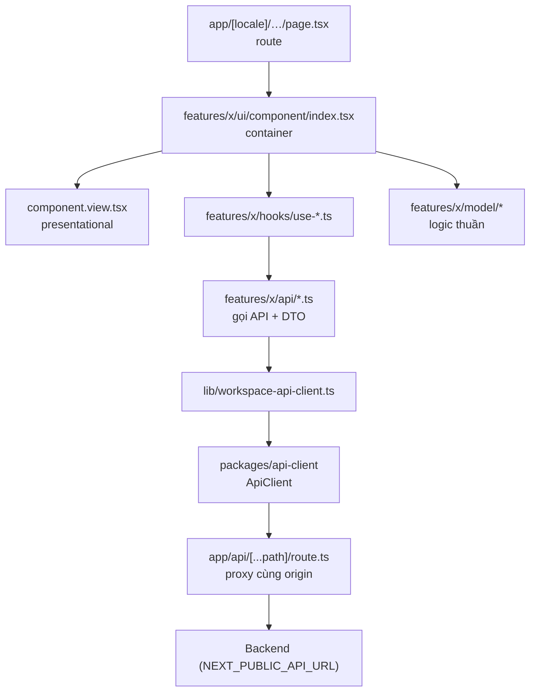
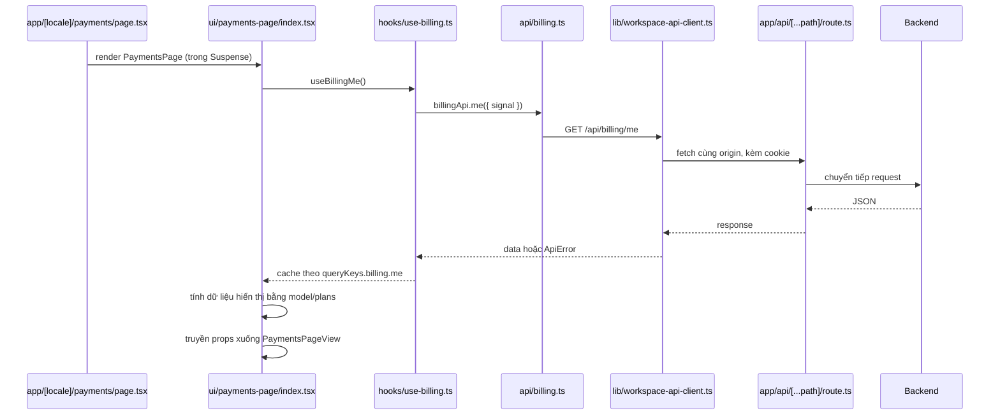
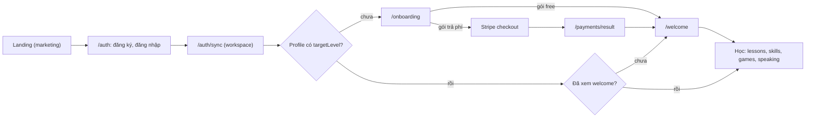
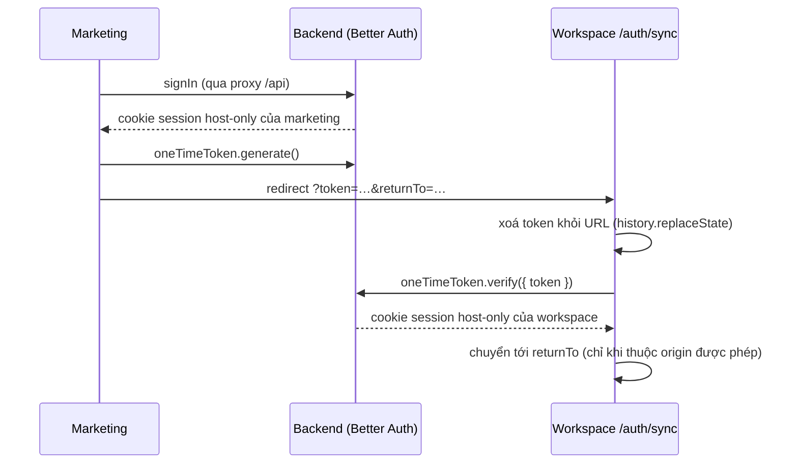
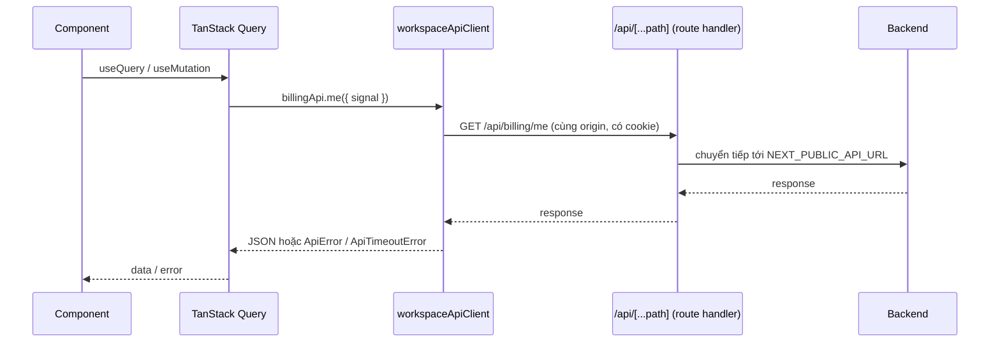
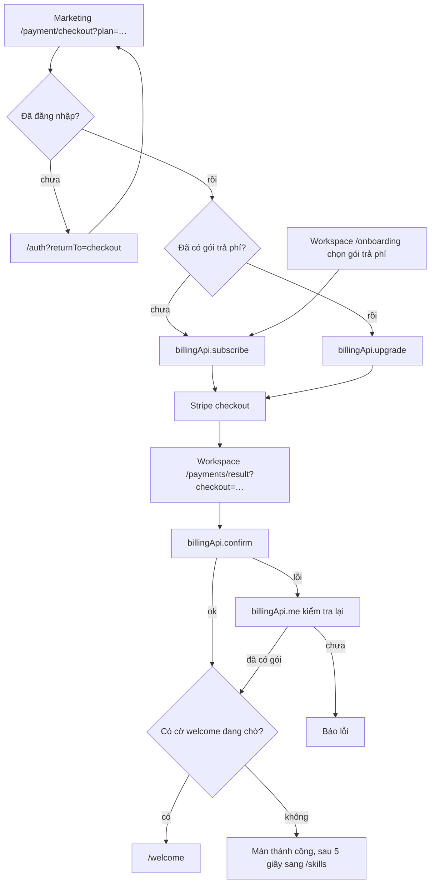
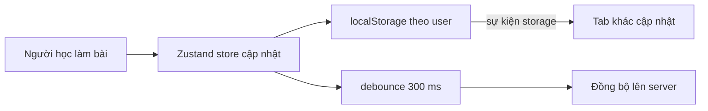

# EngliTutor frontend (`fe`)

Frontend của EngliTutor (AI English tutor): một **monorepo pnpm** gồm 2 app Next.js 16 và 5 package dùng chung. Mọi request API đi qua proxy cùng origin để cookie đăng nhập luôn là cookie first-party.

| Workspace             | Package name              | Port | Vai trò                                                                                  |
| --------------------- | ------------------------- | ---- | ---------------------------------------------------------------------------------------- |
| `apps/workspace`      | `engli-tutor-fe`          | 3000 | App học (cần đăng nhập): bài học, kỹ năng, game, tutor chat, speaking, billing, settings |
| `apps/marketing`      | `engli-tutor-web`         | 3002 | Landing, pricing, đăng ký/đăng nhập, checkout, policy                                    |
| `packages/api-client` | `@engli-tutor/api-client` | –    | Fetch client: interceptor, timeout, `ApiError`                                           |
| `packages/auth`       | `@engli-tutor/auth`       | –    | Better Auth client + đồng bộ session giữa 2 host                                         |
| `packages/i18n`       | `@engli-tutor/i18n`       | –    | Locale, cookie, message en/vi                                                            |
| `packages/legal`      | `@engli-tutor/legal`      | –    | Nội dung điều khoản, chính sách                                                          |
| `packages/ui`         | `@engli-tutor/ui`         | –    | Design system (Radix + Tailwind)                                                         |

---

## 1. Giải thích type source tree

Source kết hợp ba kiểu tổ chức, mỗi kiểu ở một cấp:

- **Monorepo (pnpm workspace).** `pnpm-workspace.yaml` khai báo `apps/`* và `packages/`*. Package nội bộ được tham chiếu bằng `workspace:*` và trỏ thẳng vào `src/index.ts`; Next.js biên dịch chúng qua `transpilePackages`, nên khi dev không cần build trước.
- **Feature-based (vertical slice).** Trong mỗi app, code gom theo nghiệp vụ (`learn`, `payments`, `tutor-chat`…), không gom theo loại file (`components/`, `hooks/`…).
- **Container / Presentational.** Mỗi component màn hình có `index.tsx` lo dữ liệu, hook và sự kiện; `*.view.tsx` chỉ nhận props và render.

Vì sao kết hợp như vậy:

| Kiểu                       | Giải quyết vấn đề gì                                                                                      | Đánh đổi                                                                  |
| -------------------------- | --------------------------------------------------------------------------------------------------------- | ------------------------------------------------------------------------- |
| Monorepo                   | Hai app dùng chung UI, auth, i18n, api client mà không publish package; đổi một chỗ, cả hai app nhận ngay | Cần build packages trước khi build app; lockfile chung                    |
| Feature-based              | Sửa một nghiệp vụ chỉ đụng một thư mục; xoá feature là xoá một thư mục + route                            | Dễ phát sinh phụ thuộc chéo giữa feature nếu không giữ kỷ luật `index.ts` |
| Container / Presentational | View dễ đọc, dễ đổi giao diện; logic dữ liệu tách khỏi JSX                                                | Thêm một file cho mỗi màn hình                                            |

```text
fe/
├── apps/
│   ├── workspace/        # engli-tutor-fe
│   └── marketing/        # engli-tutor-web
├── packages/
│   ├── api-client/  auth/  i18n/  legal/  ui/
├── scripts/              # install, add-module, check-i18n, test-setup
├── Dockerfile            # một image cho mỗi app (--build-arg APP=workspace|marketing)
└── docker-compose.yml
```

## 2. Phân tích cách tổ chức source tree

### Quy ước thư mục

```text
apps/<app>/
├── app/                  # chỉ route: page / layout / loading / route.ts, gần như không có logic
├── features/<feature>/
│   ├── api/              # gọi API + DTO type (luôn là thư mục)
│   ├── hooks/            # React hook (use-*.ts)
│   ├── model/            # logic thuần, store, hằng số; *.test.ts đặt cạnh file
│   ├── lib/              # (tuỳ chọn) helper không phải React, riêng của feature
│   ├── ui/<component>/   # index.tsx (container) + <component>.view.tsx (presentational)
│   ├── ui/shared/        # component nhỏ chỉ dùng trong feature
│   └── index.ts          # public API của feature
├── lib/                  # hạ tầng app: api client, auth client, query, seo, server-i18n
├── providers/            # provider toàn app
├── scripts/              # script riêng của app
├── public/
└── proxy.ts              # edge routing (locale, guard /login)
packages/<pkg>/src/       # không import ngược từ apps
```

### Quy tắc

- Phụ thuộc một chiều: `app/` → `features/*/ui` → `features/*/hooks` → `features/*/api`, `model` → `lib/` → `packages/*`.
- Feature khác chỉ import qua `@/features/<feature>` (tức `index.ts`); trong cùng feature dùng đường dẫn tương đối. Ngoại lệ: `import()` động được trỏ thẳng vào một module để tách chunk.
- Component chỉ hiển thị có thể bỏ `.view.tsx`, nhưng vẫn nằm trong `ui/<component>/index.tsx`.
- Thư mục và file dùng kebab-case; tên feature giống nhau giữa hai app (vd. `payments`).
- Route chỉ có một cây `app/[locale]/…`; `proxy.ts` redirect URL không có locale.

### Phụ thuộc giữa các feature

- `i18n` (workspace) là feature nền: gần như mọi feature đều import `useWorkspaceI18n` / `LocalizedLink`.
- `payments` được nhiều feature dùng để kiểm tra quyền theo gói (`planAllows`, `dailyRemaining`, `useUpgradeModal`).
- `settings` cung cấp preferences (cấp độ, tốc độ đọc, giao diện) cho `learn`, `speaking-lab`, `pwa`.
- Có vòng phụ thuộc ở cấp feature (vd. `learn` ↔ `settings`, `payments` ↔ `onboarding`). An toàn vì giá trị import chỉ được dùng bên trong component/hàm, không dùng ngay khi module nạp. Khi thêm code, **không** dùng giá trị import từ feature khác ở top-level module.
- Marketing gọn hơn: `auth`, `legal` là lá; `marketing` ↔ `payments` dùng chung model gói.

### Feature hiện có

| App       | Feature                                                                                                                                                                      |
| --------- | ---------------------------------------------------------------------------------------------------------------------------------------------------------------------------- |
| workspace | `accounts`, `auth`, `i18n`, `layout`, `learn`, `legal`, `notifications`, `onboarding`, `payments`, `pwa`, `referrals`, `settings`, `speaking-lab`, `translate`, `tutor-chat` |
| marketing | `auth`, `i18n`, `layout`, `legal`, `marketing`, `payments`                                                                                                                   |

### Route workspace (`/{locale}/…`)

| Route                                                                | Feature                                                        |
| -------------------------------------------------------------------- | -------------------------------------------------------------- |
| `/`                                                                  | Trang chủ học (`learn`)                                        |
| `/lessons`, `/lessons/progress`, `/progress`, `/search`, `/practice` | Bài học, tiến độ, tìm kiếm, luyện tập                          |
| `/skills`, `/skills/[skill]`, `/skills/[skill]/[exerciseId]`         | 4 kỹ năng và bài tập                                           |
| `/games`, `/games/[slug]`                                            | Game từ vựng                                                   |
| `/speaking`                                                          | Speaking lab + AI tutor                                        |
| `/payments`, `/payments/result`                                      | Gói và kết quả thanh toán                                      |
| `/settings/*`                                                        | account, billing, learning, notifications, referrals, security |
| `/accounts`, `/onboarding`, `/welcome`                               | Hồ sơ và onboarding                                            |
| `/login`, `/auth/sync`, `/policy`, `/policy/cookies`                 | Public                                                         |

Marketing: `/{locale}`, `/auth`, `/auth/sync`, `/payment`, `/payment/checkout`, `/policy`, `/policy/cookies`.

### Flow qua source tree

Mục này mô tả một request đi qua các lớp thư mục; flow nghiệp vụ (đăng nhập, onboarding, thanh toán) xem mục 3.8.



Ví dụ thật: màn `/payments` của workspace.



- Route chỉ import `PaymentsPage` qua `@/features/payments` (tức `index.ts`) và bọc `Suspense`.
- Container gọi hook, tính toán bằng `model/plans` (`currentPlanDetails`, `usageRows`…), rồi truyền props cho `payments-page.view.tsx`.
- Mutation (`useSubscribe`, `useUpgradePlan`) đi cùng đường đó; khi thành công thì `invalidateQueries(billingMeQueryKey)` để màn hình tự cập nhật.

Vai trò từng lớp:

| Lớp                        | Được làm                                                                                   | Không làm                   | Được import                                                                                                         |
| -------------------------- | ------------------------------------------------------------------------------------------ | --------------------------- | ------------------------------------------------------------------------------------------------------------------- |
| `app/`                     | Khai báo route, layout, `Suspense`, metadata                                               | Gọi API, chứa logic         | `@/features/<x>`, `lib/`                                                                                            |
| `ui/<component>/index.tsx` | Gọi hook, xử lý sự kiện, ghép dữ liệu                                                      | Render JSX phức tạp         | `hooks`, `model`, `api`, feature khác qua `index.ts`                                                                |
| `*.view.tsx`               | Nhận props và render; có thể dùng `useWorkspaceI18n` và state UI cục bộ                    | Gọi query/mutation, gọi API | `packages/ui`, `ui/shared`, `model` (hằng số, hàm format), type từ `api`, component của feature khác qua `index.ts` |
| `hooks/`                   | TanStack Query, store, effect                                                              | Render                      | `api`, `model`, `lib/query`                                                                                         |
| `api/`                     | Hàm gọi API, DTO type                                                                      | Import React                | `lib/*-api-client`                                                                                                  |
| `model/`                   | Hàm thuần, store Zustand, hằng số; có thể dùng storage hoặc gọi `api` khi là logic đồng bộ | Render JSX                  | `api`, `lib/`, `packages/*`                                                                                         |
| `lib/`                     | Hạ tầng của app (api client, auth, query, seo)                                             | Chứa logic nghiệp vụ        | `packages/*`; hạn chế import `features/` (hiện chỉ `marketing/lib/auth-client.ts` dùng `@/features/auth`)           |
| `packages/*`               | Code dùng chung cho 2 app                                                                  | Import từ `apps/`           | Package khác                                                                                                        |

`model/` và `.view.tsx` là tuỳ chọn: màn hình đơn giản có thể không có `model/`, và component chỉ hiển thị có thể gộp vào `index.tsx`. Logic thuần cần test nên tách riêng file (vd. `lesson-progress.logic.ts`) khỏi phần có side effect.

Khi build: package nội bộ trỏ thẳng vào `src/index.ts` và được Next biên dịch qua `transpilePackages`, nên khi dev sửa package là app nhận ngay. Build production tạo bản `output: "standalone"` cho mỗi app, kèm code package đã được trace (mục 3.7).

## 3. Mô hình chi tiết của source

### 3.1 Luồng request: proxy cùng origin

1. Component gọi hook (vd. `useBillingMe`).
2. Hook dùng TanStack Query gọi `billingApi.me({ signal })`.
3. `workspaceApiClient` (một `ApiClient`) gửi request tương đối `/api/billing/me`, cùng origin với trang.
4. Route handler `app/api/[...path]/route.ts` chuyển tiếp sang `NEXT_PUBLIC_API_URL`.

Nhờ vậy cookie session là host-only của chính domain frontend, không bị Safari ITP hay Chrome chặn cookie bên thứ ba. Proxy là route handler chứ không phải `rewrites`, vì rewrite chuyển nguyên header `Origin` của trình duyệt sang API và Better Auth sẽ trả `INVALID_ORIGIN`.

### 3.2 `ApiClient`

- Interceptor cho request, response, error (workspace dùng để xử lý `401`).
- Timeout mặc định 30 giây; đặt lại qua `timeoutMs` cho client hoặc từng request (`0` là tắt). API AI (`tutor/chat`, `translate`) dùng 90 giây.
- Hết giờ ném `ApiTimeoutError`; caller tự huỷ vẫn là `AbortError`. Timer chạy tới khi đọc xong body.
- Signal của React Query được truyền xuống, nên query bị huỷ khi rời trang.
- Response lỗi thành `ApiError` (`status`, `message`, `body`).

### 3.3 Edge routing (`proxy.ts`)

- URL không có locale → redirect `/{locale}/…` (locale lấy từ cookie, rồi `Accept-Language`) và ghi cookie.
- Workspace: người đã đăng nhập mở `/login` bị chuyển về `returnTo`. Nếu `returnTo` là URL tuyệt đối (trỏ sang marketing) thì để trang login xử lý vì cần đồng bộ session trước.

### 3.4 Auth và đồng bộ session giữa 2 host

- `createEngliAuthClient()` tạo Better Auth client có plugin `oneTimeTokenClient`.
- Đăng nhập ở marketing → `redirectAfterSignIn` gọi `startSessionSync`: tạo one-time token, chuyển sang `/auth/sync` của workspace, workspace đổi token lấy session cookie của mình rồi quay về đích. Chiều ngược lại tương tự.
- `resolveAllowedUrl` / `isAllowedSyncOrigin` chỉ cho chuyển tới đúng origin của marketing và workspace (chống open redirect).
- `AuthGate` bảo vệ mọi route workspace trừ `/login`, `/auth/sync`, `/policy`.

### 3.5 Quản lý state

| Loại state                    | Công cụ                     | Ví dụ                             |
| ----------------------------- | --------------------------- | --------------------------------- |
| Dữ liệu từ server             | TanStack Query              | account, billing, catalog bài học |
| Lưu cục bộ trước, đồng bộ sau | Zustand                     | lesson progress, bài yêu thích    |
| Cài đặt giao diện             | localStorage + window event | theme, accent, cỡ chữ             |
| Form                          | react-hook-form + zod       | onboarding, accounts              |
| State tạm của UI              | `useState` / Context        | dialog, toast, upgrade modal      |

TanStack Query: `staleTime: 0`, `refetchOnWindowFocus: false`, `retry: 1`, giữ tham chiếu cũ khi dữ liệu không đổi (`keepIfUnchanged`). Query key tập trung ở `lib/query/keys.ts`.

Lesson progress có ba lớp:

- `model/lesson-progress.logic.ts`: hàm thuần (parse, merge, chuyển trạng thái), trả về đúng object cũ khi không có thay đổi. Có test.
- `model/lesson-progress.ts`: store Zustand; localStorage tách theo user; đồng bộ lên server sau 300 ms kể từ lần sửa cuối, chỉ sau lần hydrate đầu. Lần đăng nhập đầu, progress lúc chưa đăng nhập được merge lên server (entry có `updatedAt` mới hơn thắng). Đồng bộ giữa tab qua sự kiện `storage`.
- `hooks/use-lesson-progress.ts`: hook đọc từ store.

### 3.6 Thứ tự provider (workspace)

```text
QueryProvider
└─ WorkspaceI18n
   └─ AppearanceProvider
      └─ LessonProgressSync
         └─ ActionDialogProvider → ToastProvider → UpgradeModalProvider → SignOutLoadingProvider
            ├─ GlobalNavigationLoading, ServiceWorkerRegistrar, PreventZoom
            └─ AuthGate
               ├─ PushRegistrar
               └─ AppShell → children
```

### 3.7 Build và deploy

- `next.config.ts` dùng `output: "standalone"` với `outputFileTracingRoot` là gốc monorepo.
- **Production chính:** GitLab CI (`deploy:vps`) rsync source lên VPS, ghi `.env.production` của từng app từ biến `ENV_WORKSPACE_BASE64` / `ENV_MARKETING_BASE64`, rồi build và chạy bằng Docker Compose (`Dockerfile` build một image cho mỗi app). Chỉ app có thay đổi mới được build lại. Hướng dẫn đầy đủ: [`docs/DEPLOY_VPS.md`](docs/DEPLOY_VPS.md).
- Workspace là PWA: `public/sw.js`, manifest, web push. Khi dev, `allowedDevOrigins` cho phép mở từ điện thoại qua IP LAN.

### 3.8 Flow hoạt động

#### Hành trình người dùng



#### Đăng nhập và đồng bộ session giữa 2 host



- Bắt đầu: `redirectAfterSignIn` (`apps/*/lib/auth-client.ts`) → `startSessionSync` (`packages/auth/src/session-sync.ts`).
- Kết thúc: `SessionSyncPage` → `completeSessionSync`. Token sai hoặc hết hạn chỉ khiến host nhận vẫn chưa đăng nhập.
- Không sync khi hai host cùng hostname (chỉ khác port), vì cookie không phân biệt port; khi đó chỉ redirect thường.
- Đăng nhập ở workspace (`/login`) đi theo chiều ngược lại: sync session sang marketing rồi quay về `returnTo`.

#### Điều hướng trong `AuthGate`

`AuthGate` (`providers/auth-gate.tsx`) chạy trên mọi trang workspace, lấy session (`useSession`) rồi profile (`accountApi.get`), và quyết định theo thứ tự:

| Điều kiện                                         | Kết quả                                        |
| ------------------------------------------------- | ---------------------------------------------- |
| Route public (`/login`, `/auth/sync`, `/policy*`) | Render luôn                                    |
| Chưa đăng nhập                                    | `/login?returnTo=<trang hiện tại>`             |
| Đã đăng nhập mà mở `/login`                       | `redirectAfterSignIn(returnTo)`                |
| Profile chưa có `targetLevel` (`needsOnboarding`) | `/onboarding?returnTo=…`                       |
| Chưa có `welcomeSeenAt` (`hasSeenWelcome`)        | `/welcome?returnTo=…` (trừ `/payments/result`) |
| Còn lại                                           | Render trang                                   |

Trong lúc chờ session hoặc profile, `AuthSplash` được hiển thị. `returnTo` luôn qua `safeOnboardingReturnTo` / `getSafeReturnTo` để chỉ nhận path nội bộ hoặc origin marketing.

#### Gọi API



- `NEXT_PUBLIC_AUTH_SAME_ORIGIN` được `next.config.ts` đặt là `true`, nên client dùng URL tương đối. Nếu tắt cờ này, client gọi thẳng `NEXT_PUBLIC_API_URL` và cookie trở thành cookie bên thứ ba.
- Gặp `401` ở bất kỳ trang nào (trừ `/login`): error interceptor chuyển sang `/{locale}/login?returnTo=<trang hiện tại>`.
- Sau mutation, hook gọi `invalidateQueries` theo key trong `lib/query/keys.ts` để làm mới dữ liệu liên quan.

#### Thanh toán



- Checkout ở marketing: `PaymentCheckoutPage`; gói free thì chuyển sang trang auth thay vì thanh toán.
- Từ onboarding: lưu profile, gọi `subscribe`, rồi `setWelcomePending(returnTo)` (sessionStorage) để sau khi thanh toán xong thì vào `/welcome`.
- `PaymentResultPage` chỉ confirm một lần cho mỗi lần redirect, sau đó làm mới `billingMeQueryKey`. Huỷ hoặc lỗi thì xoá cờ welcome.
- Quyền theo gói trong app: `planAllows`, `dailyRemaining`; vượt giới hạn thì mở `useUpgradeModal`.

#### Lesson progress



Chi tiết merge khi đăng nhập lần đầu và các lớp logic/store/hook: xem mục 3.5.

## 4. Tech stack

| Hạng mục        | Công nghệ                                                         |
| --------------- | ----------------------------------------------------------------- |
| Framework       | Next.js 16.2 (App Router, `proxy.ts`, Turbopack), React 19.2      |
| Ngôn ngữ        | TypeScript 5.9 (strict)                                           |
| Styling         | Tailwind CSS 4.3, `tw-animate-css`, CVA, `tailwind-merge`, `clsx` |
| UI primitive    | Radix UI 1.6 (`radix-ui`), icon `lucide-react` 1.28               |
| Animation       | Motion 12                                                         |
| Server state    | TanStack Query 5.101                                              |
| Client state    | Zustand 5.0, Context, `useSyncExternalStore`                      |
| Form / validate | react-hook-form 7.83, zod 4.4, `@hookform/resolvers` 5            |
| Auth            | Better Auth 1.3 (plugin one-time token)                           |
| Fetch           | `@engli-tutor/api-client` (trên `fetch`)                          |
| i18n            | `@engli-tutor/i18n` (en/vi, cookie, URL có prefix locale)         |
| Test            | Node test runner (`node --test`, chạy TypeScript trực tiếp)       |
| Tooling         | pnpm 11.7 workspace, `oxfmt`, `tsc --noEmit` làm lint             |
| Runtime         | Node 22 (Docker image `node:22-bookworm-slim`)                    |
| Deploy          | Docker Compose trên VPS qua GitLab CI                             |

## 5. Thư viện đang dùng và lợi ích, so sánh với các thư viện khác

Tóm tắt:

| Nhóm         | Đang dùng                 | Phương án thay thế               | Lý do chọn                                               |
| ------------ | ------------------------- | -------------------------------- | -------------------------------------------------------- |
| Server state | TanStack Query            | SWR, RTK Query                   | Mutation + invalidation mạnh, không cần Redux            |
| Client state | Zustand                   | Redux Toolkit, Jotai, Context    | Nhỏ, không provider, dùng được ngoài React               |
| Fetch        | `api-client` tự viết      | axios, ky, ofetch                | Không dependency, giữ option cache của Next              |
| UI           | Radix + Tailwind (shadcn) | MUI, Ant Design, Chakra, Mantine | Accessibility sẵn, toàn quyền style, hợp RSC             |
| Form         | react-hook-form + zod     | Formik, TanStack Form, Yup       | Ít re-render, schema sinh type                           |
| Auth         | Better Auth               | Auth.js, Clerk, Auth0            | Tự host, plugin đồng bộ session đa domain                |
| i18n         | Tự viết                   | next-intl, react-i18next         | Đủ cho en/vi, không dependency                           |
| Test         | `node --test`             | Vitest, Jest                     | Không dependency; cân nhắc Vitest khi cần test component |

Chi tiết:

### Server state: TanStack Query

- **Lợi ích:** cache theo query key, dedupe request, refetch, huỷ qua `signal`, `invalidateQueries` sau mutation.
- **vs SWR:** nhẹ hơn nhưng mutation và invalidation yếu hơn; app có nhiều mutation (billing, account).
- **vs RTK Query:** bắt buộc Redux, dự án không cần.
- **vs** `useEffect` **+ fetch:** phải tự lo race condition, cache, retry. Marketing vẫn làm kiểu này trong `payments/hooks/use-billing-me.ts`.

### Client state: Zustand

- **Lợi ích:** khoảng 1 KB, không cần provider, đọc ghi được ngoài React (`getState`/`setState`, hợp với logic đồng bộ), selector chỉ render lại component liên quan.
- **vs Redux Toolkit:** nhiều boilerplate; đáng dùng khi state toàn cục lớn.
- **vs Jotai:** mạnh với state chia nhỏ thành atom; lesson progress là một object cần persist và sync nên hợp store hơn.
- **vs Context:** mọi consumer render lại khi value đổi, không dùng được ngoài React.

### Fetch: `api-client` tự viết

- **Lợi ích:** không thêm dependency, chạy trên edge và server; giữ được option `cache` của Next; có interceptor, timeout, typed error.
- **vs axios:** có sẵn interceptor/timeout nhưng nặng hơn (~13 KB), dùng XHR trên trình duyệt, không áp dụng được option cache của Next.
- **vs ky / ofetch:** API tương tự nhưng thêm dependency. Đánh đổi: tự bảo trì, bù lại đã có test.

### UI: Radix + Tailwind theo mô hình shadcn (`@engli-tutor/ui`)

- **Lợi ích:** Radix lo accessibility (focus trap, ARIA, bàn phím) mà không áp style; Tailwind + CVA lo biến thể; code nằm trong repo, dùng chung cho 2 app.
- **vs MUI / Ant Design:** nhiều component sẵn nhưng bundle lớn, khó thoát phong cách, CSS-in-JS không hợp React Server Components.
- **vs Chakra / Mantine:** nhanh nhưng phụ thuộc hệ style của thư viện; Tailwind 4 + CSS variable đổi theme/accent theo user dễ hơn.
- **vs Headless UI:** cùng triết lý nhưng ít primitive hơn.

### Form: react-hook-form + zod

- **Lợi ích:** input uncontrolled nên ít re-render; schema zod vừa validate vừa sinh type.
- **vs Formik:** render lại nhiều hơn, bảo trì chậm.
- **vs TanStack Form:** type-safe tốt nhưng hệ sinh thái còn non.
- **vs Valibot / Yup:** Valibot nhẹ hơn; zod 4 đã nhanh, nhỏ và phổ biến nhất.

### Auth: Better Auth

- **Lợi ích:** tự host, dữ liệu trong database của mình; client có type; plugin one-time token giải quyết đồng bộ session 2 domain; session bằng cookie hợp với proxy cùng origin.
- **vs Auth.js (NextAuth):** gắn chặt Next.js, khó tuỳ biến flow email/password và đa domain.
- **vs Clerk / Auth0:** nhanh nhưng tính phí theo MAU, dữ liệu ở bên thứ ba.
- **vs Lucia:** đã ngừng phát triển.

### i18n: `@engli-tutor/i18n` tự viết

- **Lợi ích:** đủ cho en/vi, message JSON, URL có prefix locale, cookie, dùng được cả server lẫn client, không thêm dependency.
- **vs next-intl:** có pluralization, format ICU, middleware sẵn; nên cân nhắc khi thêm ngôn ngữ hoặc định dạng phức tạp.
- **vs react-i18next:** hệ sinh thái lớn nhưng tích hợp App Router / RSC kém tự nhiên hơn.

### Khác

- **Motion:** animation khai báo, layout animation, cử chỉ; `tw-animate-css` cho hiệu ứng đơn giản.
- `lucide-react`**:** icon tree-shakable.
- `react-phone-number-input`**:** nhập và validate số điện thoại theo quốc gia.

---

## Phụ lục: cài đặt, chạy và triển khai

### Cài đặt

```bash
corepack enable
pnpm install:all          # hoặc: pnpm install:workspace | install:marketing | install:packages
pnpm module:add date-fns  # thêm dependency cho cả hai app
```

### Development

```bash
cp apps/workspace/.env.local.example apps/workspace/.env.local
cp apps/marketing/.env.local.example apps/marketing/.env.local
pnpm dev:workspace   # http://localhost:3000
pnpm dev:marketing   # http://localhost:3002
```

### Biến môi trường

| Biến                        | App       | Mục đích                                                            |
| --------------------------- | --------- | ------------------------------------------------------------------- |
| `NEXT_PUBLIC_API_URL`       | cả hai    | Origin của backend                                                  |
| `NEXT_PUBLIC_SITE_URL`      | cả hai    | Origin public của chính app (Open Graph, link tuyệt đối)            |
| `NEXT_PUBLIC_MARKETING_URL` | workspace | Origin của marketing                                                |
| `NEXT_PUBLIC_APP_URL`       | marketing | Origin của workspace (không được là localhost khi build production) |
| `GOOGLE_MAPS_API_KEY`       | workspace | Key server-only cho Google Places autocomplete                      |

Production (`harrybox.cloud`):

```text
NEXT_PUBLIC_API_URL=https://api.harrybox.cloud
NEXT_PUBLIC_MARKETING_URL=https://harrybox.cloud
NEXT_PUBLIC_APP_URL=https://app.harrybox.cloud
NEXT_PUBLIC_SITE_URL=https://harrybox.cloud        # marketing; workspace dùng https://app.harrybox.cloud
```

Backend cần khớp `WEB_ORIGIN`, `LANDING_ORIGIN` (xem `[../be/README.md](../be/README.md)`).

### Lệnh

| Lệnh                                                        | Mô tả                                                 |
| ----------------------------------------------------------- | ----------------------------------------------------- |
| `pnpm build:pkg`                                            | Build packages                                        |
| `pnpm build`                                                | Packages + cả hai app                                 |
| `pnpm lint`                                                 | Typecheck                                             |
| `pnpm test`                                                 | Node test runner cho mọi app/package có script `test` |
| `pnpm i18n:check`                                           | Kiểm tra key en/vi khớp nhau                          |
| `pnpm ci:lint` / `pnpm ci:build`                            | i18n + typecheck / build toàn bộ                      |
| `pnpm ci:workspace` / `pnpm ci:marketing`                   | Lint + build từng app                                 |

Format: `pnpm exec oxfmt --write apps packages` (config `.oxfmtrc.json`).

### Docker

```bash
docker compose up -d --build   # cần apps/<app>/.env.production; NEXT_PUBLIC_* được bake lúc build
```

Deploy production (GitLab CI, Nginx Proxy Manager, vận hành, troubleshooting): [`docs/DEPLOY_VPS.md`](docs/DEPLOY_VPS.md).


TEST ME
